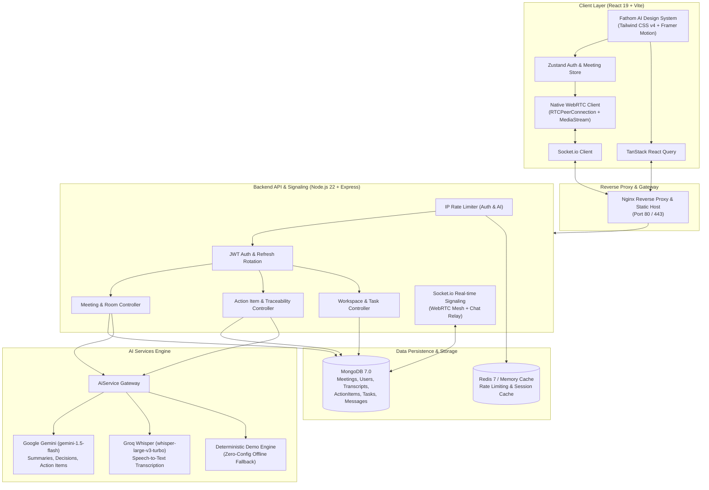

# IntellMeet – AI-Powered Enterprise Meeting & Collaboration Platform

[](https://nodejs.org)
[](https://react.dev)
[](https://www.typescriptlang.org)
[](https://vitejs.dev)
[](https://tailwindcss.com)
[](https://webrtc.org)
[](https://socket.io)
[](https://aistudio.google.com)
[](https://groq.com)
[](https://www.mongodb.com)
[](https://www.docker.com)
[](https://nodejs.org/api/test.html)

**IntellMeet** is an enterprise-grade, real-time video conferencing and meeting intelligence platform. It couples ultra-low latency WebRTC peer-to-peer audio/video streaming with automated AI meeting assistance (automated speech-to-text transcription, executive summaries, decision extraction, and Kanban task conversion).

The user interface is crafted in a **Fathom AI-inspired design aesthetic**: minimal surfaces, crisp 1px borders, generous whitespace, refined typography, and purposeful cobalt blue accents.

---

## 📑 Table of Contents
- [Key Features](#-key-features)
- [System Architecture (Mermaid)](#-system-architecture)
- [Documentation Hub](#-documentation-hub)
- [Pre-Seeded Demo Credentials](#-pre-seeded-demo-credentials)
- [Getting Started](#-getting-started)
  - [Prerequisites](#prerequisites)
  - [Local Development Setup](#local-development-setup)
  - [Docker Compose Quickstart](#docker-compose-quickstart)
- [Automated Testing & CI/CD](#-automated-testing--cicd)
- [REST API Overview](#-rest-api-overview)
- [Security & Hardening](#-security--hardening)

---

## 🌟 Key Features

1. **Ultra-Low Latency Video Conferencing (WebRTC)**:
   - Full mesh peer-to-peer WebRTC connections with STUN server resolution.
   - Dynamic video grid layout supporting multi-party video, audio, and active presenter indicators.
   - Screen sharing with seamless track replacement and real-time state broadcasts.
   - In-call chat and animated floating emoji reactions relay via Socket.io.
   - Local in-browser session recording using `MediaRecorder` API with instant WebM download.

2. **AI Post-Meeting Intelligence Hub**:
   - **Executive Summaries**: Synthesizes key discussion points, consensus decisions, and conversational sentiment via **Google Gemini** (`gemini-1.5-flash`).
   - **Speech-to-Text Transcription**: Rapid, timestamped transcription powered by **Groq Whisper** (`whisper-large-v3-turbo`).
   - **1-Click Follow-Up Email Generator**: Generates polished executive drafts ready for immediate clipboard copy or `mailto:` client dispatch.
   - **Speaker Talk-Time Ratio**: Visual meter breaking down conversational participation percentages.

3. **Transcript-to-Action-Item Traceability & Kanban Accountability**:
   - Extracted deliverables are permanently grounded in their verbatim **transcript source quotes**, speaker attribution, and timestamp references.
   - Clicking `[>] Jump to [timestamp]` switches to the transcript viewer and highlights the exact speaker turn.
   - **1-Click Kanban Push**: Converts action items into workspace tasks, embedding the transcript quotation into the task description.
   - Real-time interactive Kanban task board synchronized across clients via Socket.io.

4. **Meetings Library & Global Search**:
   - Filter pills (All, Starred ⭐, Live, Scheduled, AI Notes, Completed).
   - Instant star bookmarking toggle persisted to MongoDB.
   - Global command palette (`Ctrl+K`) for rapid navigation across meetings, tasks, and system actions.

---

## 🏗 System Architecture



---

## 📚 Documentation Hub

Detailed documentation is available in the [`docs/`](docs/) directory:

- 📖 **[REST API Documentation](docs/API_DOCUMENTATION.md)**: Exhaustive endpoint catalog with request/response schemas, status codes, and Socket.io event protocol.
- 📋 **[Internship Project Report](docs/PROJECT_REPORT.md)**: Comprehensive evaluation report covering problem scope, architectural blueprint, security measures, and test evidence.
- 🎬 **[Walkthrough & Reflection Video Outlines](docs/WALKTHROUGH_AND_REFLECTION_OUTLINES.md)**: Scene-by-scene script outlines for feature walkthrough and internship reflection presentations.

---

## 👥 Pre-Seeded Demo Credentials

The platform includes 4 pre-configured enterprise personas with verified credentials:

| Name | Role | Email | Password |
|---|---|---|---|
| **Alex Rivera** | Workspace Host / Admin | `alex.admin@intellmeet.io` | `Password123!` |
| **Sarah Chen** | Lead Frontend Engineer | `sarah.dev@intellmeet.io` | `Password123!` |
| **Marcus Vance** | DevOps & Infrastructure | `marcus.ops@intellmeet.io` | `Password123!` |
| **Priya Patel** | Security & Compliance | `priya.sec@intellmeet.io` | `Password123!` |

*(New user accounts can also be created instantly via `/register`)*

---

## 🚀 Getting Started

### Prerequisites
- **Node.js**: v20.x or v22.x LTS
- **MongoDB**: v6.x or v7.x (local service or MongoDB Atlas)
- **Git**

### Local Development Setup

1. **Clone repository**:
   ```bash
   git clone https://github.com/your-username/IntellMeet.git
   cd IntellMeet
   ```

2. **Install dependencies**:
   ```bash
   npm install
   ```

3. **Configure environment**:
   ```bash
   cp .env.example .env
   ```
   *(Optional)* Configure `GEMINI_API_KEY` and `GROQ_API_KEY` for live AI processing, or leave them blank with `DEMO_MODE=true` for deterministic offline demonstration.

4. **Seed database with demo meetings & users**:
   ```bash
   npm run seed --prefix server
   ```

5. **Start frontend & backend concurrently**:
   ```bash
   npm run dev
   ```
   - Client: `http://localhost:5173`
   - Server: `http://localhost:5000`
   - Health Check: `http://localhost:5000/health`
   - Prometheus Metrics: `http://localhost:5000/metrics`

---

### 🐳 Docker Compose Quickstart

To run the complete production-grade stack (Frontend, Backend, MongoDB, Redis) via Docker:

```bash
docker compose up -d --build
```

Access the application at `http://localhost`.

---

## 🧪 Automated Testing & CI/CD

IntellMeet contains an automated end-to-end integration test suite executed via the Node.js native test runner (`node:test` + `tsx`).

Run the automated tests:
```bash
npm test --prefix server
```

### Test Results (16 Passed / 0 Failed)

```
✔ GET /health returns status UP and service statuses (66.2ms)
✔ Authentication: Register new user (165.6ms)
✔ Authentication: Login with valid credentials (169.8ms)
✔ Protected Routes: Reject access without valid JWT (2.4ms)
✔ Protected Routes: Verify /api/auth/me with bearer token (7.9ms)
✔ Meeting Management: Create new meeting and verify code generation (26.9ms)
✔ Meeting Management: Retrieve meeting by meeting code (23.9ms)
✔ Action Items: Create and list action items linked to meeting (27.1ms)
✔ Workspace & Task Management: Create workspace and kanban task (35.5ms)
✔ Error Handling: Return 400 Bad Request on invalid ObjectId format (CastError) (6.2ms)
✔ Validation: Reject registration with missing required fields (2.5ms)
✔ Meeting Management: Return 404 for non-existent meeting code and valid ObjectId (8.2ms)
✔ RBAC & Authorization: Prevent unauthorized user from modifying workspaces (96.4ms)
✔ Meeting Management: Allow host to delete meeting and verify subsequent 404 (13.0ms)
✔ Analytics: Retrieve dashboard summary and telemetry metrics (33.3ms)
✔ AI Traceability: Store action item with transcript quote, timestamp, and speaker (48.6ms)

ℹ tests 16 | pass 16 | fail 0 | duration_ms 1559.7ms
```

---

## 🔒 Security & Hardening

- **Brute-Force Rate Limiting**: IP rate limiters on `/api/auth/*` (20 req / 15m) and `/api/ai/*` (30 req / 60s).
- **Mongoose CastError Defense**: Defensive error handling prevents server crashes from malformed ObjectIDs.
- **Role-Based Access Control**: Strict host and admin verification for workspace mutations and meeting deletion.
- **JWT Refresh Rotation**: Tokens are signed with 256-bit secrets and support automated session renewal.
- **Sanitized Headers**: Helmet protection, strict CORS origins, and stripped password hashes across all responses.

---

## 📄 License
MIT License. Built for enterprise collaboration and software engineering internship submission.
