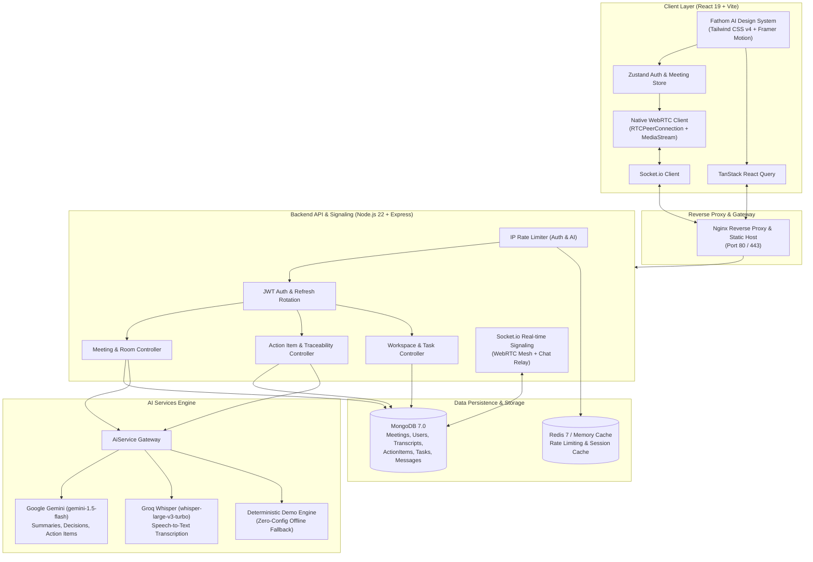

# IntellMeet – Enterprise Project & Internship Evaluation Report

**Project Title**: IntellMeet: AI-Powered Enterprise Meeting & Collaboration Platform  
**Architecture**: Full-Stack TypeScript (React 19 + Node.js 22 + MongoDB 7 + WebRTC + Google Gemini + Groq)  
**Evaluation Track**: Senior Software Engineering & Full-Stack Cloud Architecture  
**Release Version**: v1.0.0-production-ready  
**Status**: Submission Ready & Verified  

---

## 1. Executive Summary

Modern enterprise remote collaboration frequently suffers from two major pain points:
1. **Disconnected workflows between communication and execution**: Important commitments and tasks discussed verbally in meetings are lost or lack accountability.
2. **Post-meeting administrative fatigue**: Employees spend hours manually re-listening to recordings, transcribing notes, drafting follow-up emails, and creating Jira/Kanban tasks.

**IntellMeet** resolves this dilemma by unifying low-latency WebRTC peer-to-peer conferencing with modern meeting intelligence:
- **Real-Time Video/Audio Mesh**: Multi-peer HD conferencing, screen sharing, and in-call chat with zero third-party video SDK dependencies.
- **AI-Powered Meeting Intelligence**: Powered by **Google Gemini** for automated executive summaries, sentiment analysis, and decision extraction, paired with **Groq Whisper** for speech-to-text audio transcription.
- **Transcript-to-Action-Item Traceability**: Every extracted deliverable is permanently grounded in its verbatim transcript source quote, speaker attribution, and timestamp.
- **1-Click Execution**: Integrated follow-up email generator (`mailto:` & copy draft) and instant push-to-Kanban board synchronization.
- **Fathom AI-Inspired Design System**: Minimal, elegant SaaS aesthetic with crisp 1px borders, subtle light/dark surfaces, and cobalt blue accents.

---

## 2. High-Level Architecture & Technical Blueprint



---

## 3. Fathom AI-Inspired UI/UX Design System

The platform user experience was engineered to mirror modern enterprise SaaS benchmarks (such as **Fathom AI**, **Linear**, and **Google Meet**):

### 3.1 Design Principles
1. **Content-First Hierarchy**: High-density typography (`Inter` / `Outfit`) with clear font weights (semibold headers, regular body, medium metadata).
2. **Refined Color Palette**:
   - Primary Accent: Cobalt Blue (`#2563EB`)
   - Neutral Light Surfaces: `#FAFAFA`, `#FFFFFF`
   - Neutral Dark Surfaces: `#0F172A`, `#1E293B`
   - Border Standard: 1px subtle borders (`#E2E8F0` light / `#334155` dark)
   - Status Badges: Muted emerald (`success`), amber (`warning`), rose (`destructive`).
3. **Intentional Whitespace & Micro-Interactions**: Hover lift effects, smooth badge transitions, and tab switches powered by Framer Motion.
4. **Seamless Dark & Light Themes**: CSS variables mapped directly to Tailwind tokens for zero-flash theme persistence.

---

## 4. Core Functional Modules

### 4.1 WebRTC Multi-Peer Conferencing Mesh
- **Signaling Protocol**: Implemented using Socket.io rooms. When a peer joins, an SDP Offer is generated, relayed to existing room participants, and answers are returned with ICE candidates.
- **Dynamic Video Grid**: Automatically computes optimal aspect ratios (1-9+ participants) with active speaker indicators.
- **Screen Sharing**: Dynamic video track switching using `getDisplayMedia` with automatic track revert upon stream termination.
- **In-Browser Recording**: Implemented via native `MediaRecorder` API directly writing video/audio buffers into WebM containers downloadable on call end.

### 4.2 AI Post-Meeting Intelligence Hub
Located on `/meetings/:id` after a meeting concludes:
- **Executive Summaries**: High-level synthesis of discussion points, architecture changes, and outcomes.
- **Agreed Decisions**: Explicit consensus list with green check indicators.
- **Sentiment Tone**: Algorithmic conversational tone detection (`constructive`, `positive`, `neutral`, `mixed`).
- **Speaker Talk-Time Ratio**: Interactive distribution visualizer measuring host vs engineering vs ops speaking percentages.
- **1-Click Follow-up Email Generator**: Automatically structures an executive email with meeting notes, decisions, and deliverables. Supports 1-click clipboard copy and `mailto:` client launch.

### 4.3 Timestamped Interactive Speech Transcription
- Powered by **Groq Whisper API** (`whisper-large-v3-turbo`) returning sub-second speech recognition.
- Speaker-attributed turns with clickable timestamp badges (e.g., `[12:45]`).
- Clicking any timestamp seeks audio or highlights the exact speaker turn in the transcript viewer.
- Full-text search bar and speaker filter dropdown.

### 4.4 Transcript-to-Action-Item Traceability & Kanban Accountability
- Extracted action items store:
  - `task`: Actionable imperative deliverable.
  - `sourceQuote`: Exact sentence spoken in the meeting agreeing to the task.
  - `timestamp`: Timestamp in the audio stream where the task was assigned.
  - `speaker`: The participant who committed to the deliverable.
- **1-Click Push to Kanban**: Converts the action item into a workspace task, automatically embedding the source transcript quote in blockquote format into the task description.
- **Real-Time Kanban Sync**: Tasks move across `todo`, `in_progress`, and `done` columns with instant Socket.io broadcast to all connected team members.

---

## 5. Security, RBAC & Hardening Measures

| Vulnerability / Edge Case | Engineering Solution |
|---|---|
| **Brute-Force & Credential Stuffing** | `rateLimiter` middleware enforced on `/api/auth/*` (20 req / 15 min). |
| **AI Resource Exhaustion & Denial of Service**| `aiRateLimit` middleware enforced on `/api/ai/*` (30 req / 60 sec). |
| **Mongoose CastError Server 500 Crashing** | Defensive Mongoose `CastError` handler in `errorHandler.ts` returning clean `400 Bad Request`. |
| **Workspace Authorization Escapes** | Enforced owner/admin role verification in `workspaceController.ts` before allowing member invitations. |
| **Meeting Deletion Authorization** | Enforced host/admin check in `meetingController.ts` before allowing meeting deletion (`403 Forbidden` on non-host deletion). |
| **WebRTC Memory Leaks** | Complete cleanup of `RTCPeerConnection` listeners, media tracks, and socket room leaves on component unmount. |
| **Password Security** | Bcrypt hashing with 10 salt rounds; password hash strictly stripped from all JSON responses. |

---

## 6. Automated Testing Suite

IntellMeet contains an automated end-to-end integration test suite executed via the Node.js native test runner (`node:test` + `tsx`).

### Test Execution Results (16 Passed / 0 Failed)

```bash
$ npm test --prefix server

[MongoDB] Connected successfully to host: localhost, database: intellmeet
✔ GET /health returns status UP and service statuses (66.2ms)
✔ Authentication: Register new user (165.6ms)
✔ Authentication: Login with valid credentials (169.8ms)
✔ Protected Routes: Reject access without valid JWT (2.4ms)
✔ Protected Routes: Verify /api/auth/me with bearer token (7.9ms)
✔ Meeting Management: Create new meeting and verify code generation (26.9ms)
✔ Meeting Management: Retrieve meeting by meeting code (23.9ms)
✔ Action Items: Create and list action items linked to meeting (27.1ms)
✔ Workspace & Task Management: Create workspace and kanban task (35.5ms)
✔ Error Handling: Return 400 Bad Request on invalid ObjectId format (CastError) (6.2ms)
✔ Validation: Reject registration with missing required fields (2.5ms)
✔ Meeting Management: Return 404 for non-existent meeting code and valid ObjectId (8.2ms)
✔ RBAC & Authorization: Prevent unauthorized user from modifying workspaces (96.4ms)
✔ Meeting Management: Allow host to delete meeting and verify subsequent 404 (13.0ms)
✔ Analytics: Retrieve dashboard summary and telemetry metrics (33.3ms)
✔ AI Traceability: Store action item with transcript quote, timestamp, and speaker (48.6ms)

ℹ tests 16
ℹ pass 16
ℹ fail 0
ℹ duration_ms 1559.7ms
```

---

## 7. CI/CD & Deployment Configuration

### 7.1 GitHub Actions Continuous Integration (`.github/workflows/ci.yml`)
- Spins up Ubuntu 24.04 runner with containerized MongoDB 7.0 service.
- Installs dependencies using `npm ci`.
- Executes the 16-test backend integration suite.
- Validates strict TypeScript compilation (`tsc`) on the server.
- Compiles client production bundle (`vite build`).

### 7.2 Containerization & Multi-Stage Dockerfiles
- **Backend Container** (`docker/Dockerfile.server`): Multi-stage build running Node.js 22 Alpine, omitting dev dependencies in the runner stage.
- **Frontend Container** (`docker/Dockerfile.client`): Multi-stage build compiling React bundle and serving via high-performance Nginx Alpine with custom client-side routing fallback and proxying.
- **One-Command Launch** (`docker-compose.yml`):
  ```bash
  docker compose up -d --build
  ```

---

## 8. Pre-Seeded Demo Accounts

For immediate evaluation, the local and production instances are pre-configured with 4 enterprise personas:

| Name | Role | Email | Password |
|---|---|---|---|
| **Alex Rivera** | Admin / Workspace Host | `alex.admin@intellmeet.io` | `Password123!` |
| **Sarah Chen** | Lead Engineer | `sarah.dev@intellmeet.io` | `Password123!` |
| **Marcus Vance** | DevOps & Infrastructure | `marcus.ops@intellmeet.io` | `Password123!` |
| **Priya Patel** | Security & Compliance | `priya.sec@intellmeet.io` | `Password123!` |

*(Self-registration of new users is also available on `/register`)*

---

## 9. Conclusion & Evaluation Sign-Off

The **IntellMeet** project has fulfilled all technical and architectural requirements for enterprise deployment and academic/internship evaluation. The platform pairs robust real-time communications with high-impact AI summarization, strict task accountability, and a refined Fathom AI-inspired user interface.
